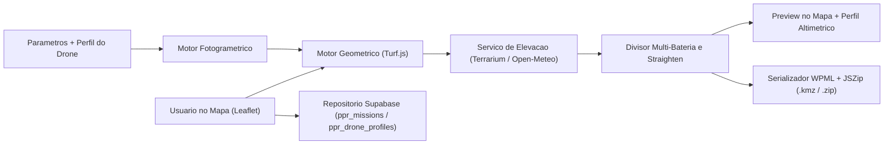
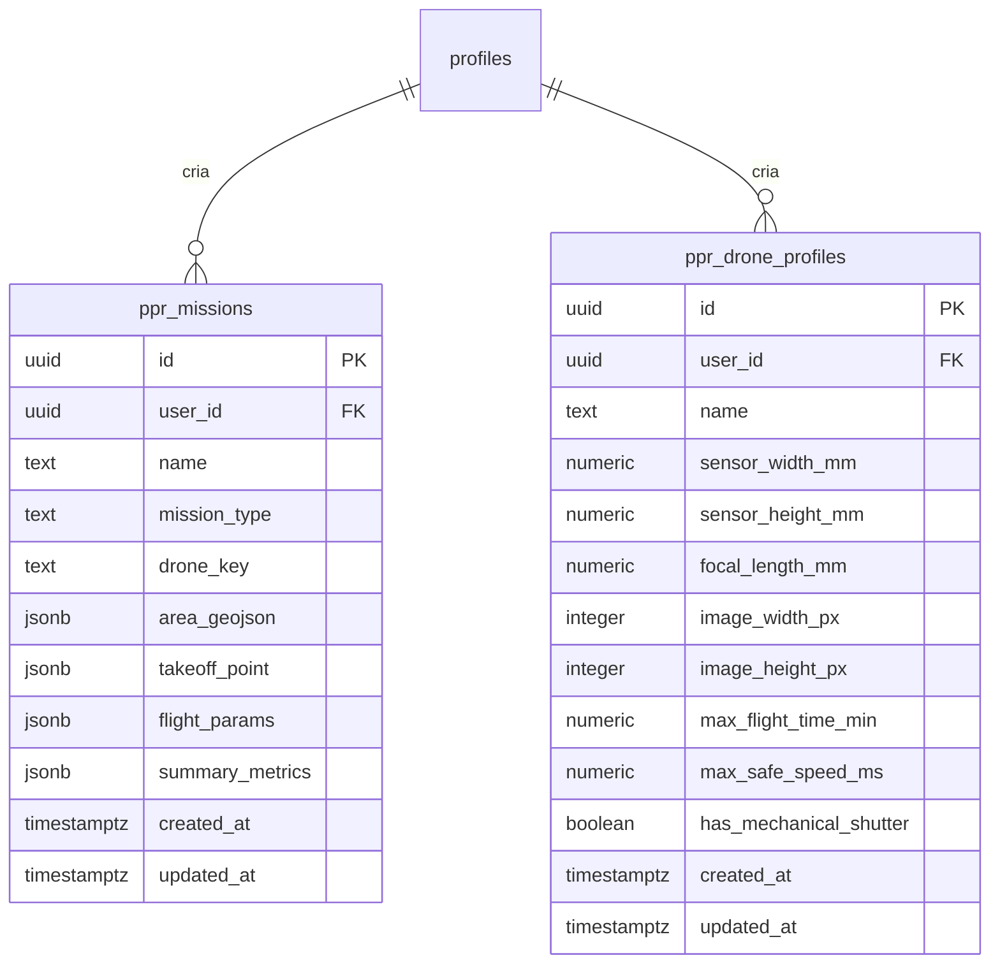

# Arquitetura do Ecossistema e da Ferramenta Pilot Pro

Este documento define a arquitetura da ferramenta **Pilot Pro** (`pilot-pro`) e consolida seu alinhamento com o ecossistema **Allan Workbench**.
O objetivo e garantir isolamento estrito, baixo acoplamento, autenticacao unificada e manutencao simplificada tanto por engenheiros quanto por agentes de IA.

---

## 1. Arquitetura do Ecossistema Allan Workbench

O **Allan Workbench** opera como um ecossistema descentralizado de micro-aplicacoes web independentes voltadas para engenharia e operacoes tecnicas.
Cada ferramenta vive em seu proprio repositorio Git, possui deploy proprio no GitHub Pages e nao importa codigo de nenhuma outra ferramenta.

### Principios Aplicados ao Pilot Pro

1. **Isolamento de contexto**: todo o codigo, documentacao e scripts SQL do Pilot Pro residem dentro de seu proprio repositorio.
2. **Portal desacoplado**: o Portal central funciona apenas como launcher dinamico baseado no catalogo do Supabase (`public.applications`).
3. **Stack minimalista sem build**: HTML5 puro, CSS3 Vanilla e JavaScript nativo (ES6+), executavel diretamente via servidor HTTP local simples sem bundlers, transpiladores ou frameworks de UI.
4. **Processamento 100% client-side**: todos os calculos fotogrametricos, geracao de geometrias, leitura de elevacao, divisao por bateria e empacotamento `.kmz` ocorrem no navegador do usuario.
5. **Persistência centralizada com isolamento logico**: o banco PostgreSQL do Supabase e compartilhado pelo ecossistema, mas os dados do Pilot Pro usam exclusivamente o prefixo `ppr_` e politicas de Row Level Security (RLS) proprias.

---

## 2. Comunicacao entre Portal e Ferramentas

A comunicacao entre o Portal central e o Pilot Pro ocorre de forma unidirecional e padronizada atraves do componente **App Bridge** (`workbench-bridge.js`).

### Mecanismo de Injecao e Ciclo de Vida

1. O `index.html` do Pilot Pro inicia com `<body style="display: none;">` para impedir renderizacao de conteudo antes da validacao da sessao.
2. O arquivo `config.js` define `CONFIG.PORTAL_URL` apontando para o Portal central (`https://allanuchoa.github.io/portal/` em producao ou URL local em desenvolvimento).
3. Um script inline no `index.html` carrega `${CONFIG.PORTAL_URL}assets/js/workbench-bridge.js` de forma assincrona (`defer`).
4. O `workbench-bridge.js` valida a sessao no Supabase, injeta o cabecalho comum no topo da pagina (logo de retorno ao Portal, seletor rapido de ferramentas permitidas, identificacao do usuario e botao de logout), revela o `<body>` e dispara o evento customizado `workbench-ready` contendo `event.detail.session`.
5. O `app.js` do Pilot Pro aguarda o evento `workbench-ready` para inicializar o mapa, carregar os planos salvos do usuario e liberar a interface.

### Regras de Integracao com o Cabecalho Compartilhado

O Pilot Pro possui layout de mapa em tela cheia.
A altura da area util da aplicacao deve descontar dinamicamente a altura do header injetado pelo `workbench-bridge.js` usando layout flex vertical (`100dvh`) para evitar barras de rolagem indesejadas.
O Pilot Pro nunca deve duplicar controles de logout ou troca de ferramenta que ja pertencem ao App Bridge.

---

## 3. Estrategia de Autenticacao Compartilhada (SSO Nativo)

A autenticacao do ecossistema e centralizada no **Supabase Auth**.
Nao ha passagem de tokens de acesso via hash ou query string na URL.

### Compartilhamento de Sessao

* **Mesma origem no GitHub Pages**: como o Portal (`https://allanuchoa.github.io/portal/`) e o Pilot Pro (`https://allanuchoa.github.io/pilot-pro/`) compartilham a origem `https://allanuchoa.github.io`, ambos acessam o mesmo `localStorage` do navegador sob a chave `sb-<SUPABASE_PROJECT_ID>-auth-token`.
* **Subdominios customizados (expansao futura)**: caso o ecossistema migre para subdominios proprios, o cliente Supabase pode ser configurado com `cookieOptions.domain` no dominio raiz sem alterar a logica de negocio do Pilot Pro.

### Requisitos Obrigatorios de Seguranca na Sessao

1. O cliente Supabase em `supabase.js` usa exclusivamente `SUPABASE_ANON_KEY` (nunca `service_role_key`).
2. A ferramenta escuta `supabaseClient.auth.onAuthStateChange` para reagir imediatamente a `SIGNED_OUT`, limpar o estado em memoria e redirecionar para `CONFIG.PORTAL_URL`.
3. Todo redirecionamento via `window.location.href` com origem externa ou vinda do banco deve validar o esquema `^https?://`.
4. Um fallback visual deve existir para erro de carregamento de CDN ou falha de comunicacao com o Supabase, evitando tela preta sem diagnostico.

---

## 4. Arquitetura Interna do Pilot Pro

### Stack Tecnologica Autorizada

| Camada | Tecnologia | Motivo |
|---|---|---|
| Estrutura e estilo | HTML5 + CSS3 Vanilla (`styles.css`) | Conformidade estrita com o Allan Workbench e `DESIGN.md`. |
| Logica de aplicacao | JavaScript ES6+ nativo (modulos separados em `js/`) | Zero etapa de build e leitura direta por humanos e agentes. |
| Mapa interativo | Leaflet (via CDN) + Esri World Imagery / Carto Dark / OSM | Gratuito, leve, sem obrigatoriedade de chave de API e com controle fino sobre desenho e edicao de geometrias. |
| Calculo geoespacial | Turf.js (via CDN) | Operacoes geodesicas precisas (projecoes, recortes de poligono, rotacao, buffers de corredor e distancias). |
| Empacotamento KMZ | JSZip (via CDN) | Geracao client-side de arquivos `.kmz` (formato ZIP com `wpmz/template.kml` e `wpmz/waylines.wpml`) e pacotes `.zip` multi-bateria. |
| Elevacao (Terrain Follow) | AWS Elevation Tiles (Terrarium SRTM 30m) + fallback Open-Meteo Elevation API | Gratuitos, acessiveis via CORS direto do navegador e sem necessidade de backend proprio. |
| Backend e autenticacao | Supabase JS v2 (via CDN) | SSO nativo, banco PostgreSQL e politicas RLS do ecossistema. |
| Hospedagem | GitHub Pages via GitHub Actions | Deploy continuo automatico na branch `main`. |

### Diagrama de Fluxo de Dados



### Organizacao Modular dos Scripts (`js/`)

Para manter o codigo facil de ler e testar sem introduzir bundler, a logica sera dividida em arquivos enxutos carregados em ordem deterministica (ou ES Modules nativos via `<script type="module">`):

* `js/drones.js`: catalogo nativo de aeronaves DJI Fly (sensor, distancia focal, resolucao, velocidade segura, autonomia util) e validacao de perfis customizados.
* `js/photogrammetry.js`: funcoes puras de calculo de footprint no solo, GSD (cm/px), espacamento entre linhas, distancia entre fotos, selecao automatica do intervalo (2, 3, 4 ou 5s), velocidade exata e alerta de arrasto (rolling shutter).
* `js/geometry.js`: geracao de linhas de voo para Grade Simples, Grade Dupla (3D) e Corredor Linear, rotacao automatica pela maior aresta, aplicacao de margem/overshoot, conversao KML/GeoJSON e insercao de pontos do Straighten Flight Path.
* `js/elevation.js`: amostragem de altitude do terreno via tiles PNG Terrarium (decodificacao RGB em canvas) com cache em memoria por tile e fallback automatico para Open-Meteo Elevation API.
* `js/battery-splitter.js`: calculo de distancia, tempo de voo, fotos estimadas, numero de baterias e fatiamento automatico em missoes parciais respeitando autonomia util e limite de waypoints por arquivo KMZ.
* `js/wpml-exporter.js`: geracao de XML `wpmz/template.kml` e `wpmz/waylines.wpml` compativeis com DJI Fly e empacotamento via JSZip.
* `js/map-controller.js`: gerenciamento do mapa Leaflet, troca de camadas, desenho e edicao de poligonos/linhas, marcador de decolagem e renderizacao das rotas coloridas por bateria.
* `js/profile-chart.js`: renderizacao em SVG/Canvas leve do perfil altimetrico (terreno vs altitude do drone vs altura relativa AGL).
* `js/storage.js`: CRUD no Supabase para `ppr_missions` e `ppr_drone_profiles`, alem de importacao/exportacao local.
* `app.js`: orquestrador principal acionado pelo evento `workbench-ready`, conectando estado, controles da interface e modulos acima.

---

## 5. Modelo de Dados e Contrato RLS no Supabase

O Pilot Pro utiliza o Registry global existente (`public.profiles`, `public.applications`, `public.user_applications`) apenas por referencia de leitura nas politicas de seguranca e registro via script de onboarding.
As politicas RLS das tabelas do Registry nunca devem ser recriadas ou removidas por scripts desta ferramenta para evitar recursao infinita (erro Postgres `42P17`).

### Tabelas Proprias do Pilot Pro (Prefixo `ppr_`)



### Seguranca em Camadas (RLS + Filtro Client-Side)

1. Todas as tabelas `ppr_*` possuem `ENABLE ROW LEVEL SECURITY`.
2. A politica valida simultaneamente que `auth.uid() = user_id` e que o usuario possui vinculo ativo na tabela `user_applications` para o slug `pilot-pro` com `applications.is_active = true`.
3. Todas as consultas no cliente incluem filtro explicito `.eq('user_id', user.id)` como defesa em profundidade.

---

## 6. Convencoes para Criacao de Novos Modulos no Ecossistema

Ao criar ou evoluir modulos no Allan Workbench, aplica-se o seguinte padrao:

1. **Identidade do modulo**: nome de exibicao claro, `slug` curto em kebab-case (`pilot-pro`), prefixo SQL exclusivo de 3 letras (`ppr_`) e categoria padrao (`Engineering` ou `Commercial`).
2. **Base obrigatoria**: iniciar a partir do scaffold oficial (`index.html`, `styles.css`, `config.js`, `supabase.js`, `app.js`, `.github/workflows/deploy.yml`, `sql/onboard-tool.template.sql`).
3. **Scripts SQL re-executaveis**: usar sempre `CREATE TABLE IF NOT EXISTS`, `CREATE OR REPLACE FUNCTION`, `DROP POLICY IF EXISTS` antes de `CREATE POLICY`, e `ON CONFLICT` nos registros de onboarding.
4. **Testabilidade da logica pura**: modulos de calculo e geracao de arquivos devem ser desacoplados do DOM para permitir verificacao automatizada rapida via Node.js.

---

## 7. Padroes de Documentacao e Estrutura do Repositorio

### Padroes de Documentacao

* **Documentos de definicao do produto e arquitetura** (na raiz durante o desenho ou organizados em `docs/` conforme ciclo de vida da ferramenta): `ARCHITECTURE.md`, `PRODUCT_VISION.md`, `PRD.md`, `PRODUCT_ROADMAP.md`, `TASKS.md`, `AGENTS.md`.
* **Documentacao operacional obrigatoria**: `README.md` na raiz (como rodar localmente e testar) e `docs/CHANGELOG.md` atualizado a cada entrega de codigo ou documentacao.
* **Referencias relativas**: links internos entre arquivos do repositorio devem usar caminhos relativos, nunca caminhos absolutos da maquina local.

### Estrutura Alvo do Repositorio `pilot-pro`

```text
pilot-pro/
├── .github/
│   └── workflows/
│       └── deploy.yml
├── docs/
│   └── CHANGELOG.md
├── js/
│   ├── battery-splitter.js
│   ├── drones.js
│   ├── elevation.js
│   ├── geometry.js
│   ├── map-controller.js
│   ├── photogrammetry.js
│   ├── profile-chart.js
│   ├── storage.js
│   └── wpml-exporter.js
├── sql/
│   ├── 001_schema_ppr.sql
│   └── setup.sql
├── tests/
│   └── run-tests.mjs
├── AGENTS.md
├── ARCHITECTURE.md
├── PRD.md
├── PRODUCT_ROADMAP.md
├── PRODUCT_VISION.md
├── README.md
├── TASKS.md
├── app.js
├── config.js
├── index.html
├── styles.css
└── supabase.js
```

---

## 8. Limites Tecnicos Conhecidos e Mitigacoes

* **Dependencia de conectividade**: o MVP exige acesso a internet para carregar tiles de satelite, consultar elevacao SRTM/Open-Meteo e validar sessao SSO no Supabase.
* **Resolucao altimetrica (SRTM 30m)**: o modelo publico tem precisao vertical aproximada de poucos metros e nao enxerga arvores isoladas, torres ou linhas de transmissao.
  A interface deve exibir aviso operacional claro e recomendar margem segura de altitude AGL.
* **Particularidades de firmware no DJI Fly**: alguns modelos consumer apresentam restricoes no numero maximo de waypoints por missao ou no comportamento de disparo continuo em WPML.
  O divisor de missoes e o modo configuravel de disparo (automatico WPML ou manual temporizado no DJI Fly) mitigam esse risco desde o MVP.
